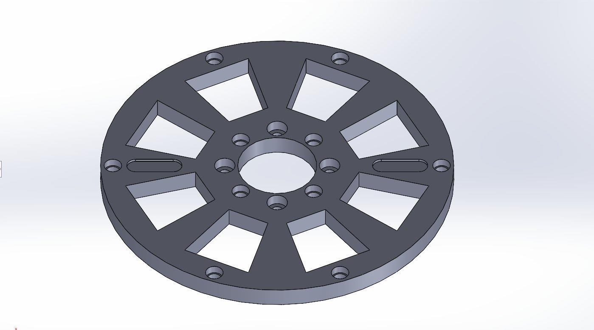
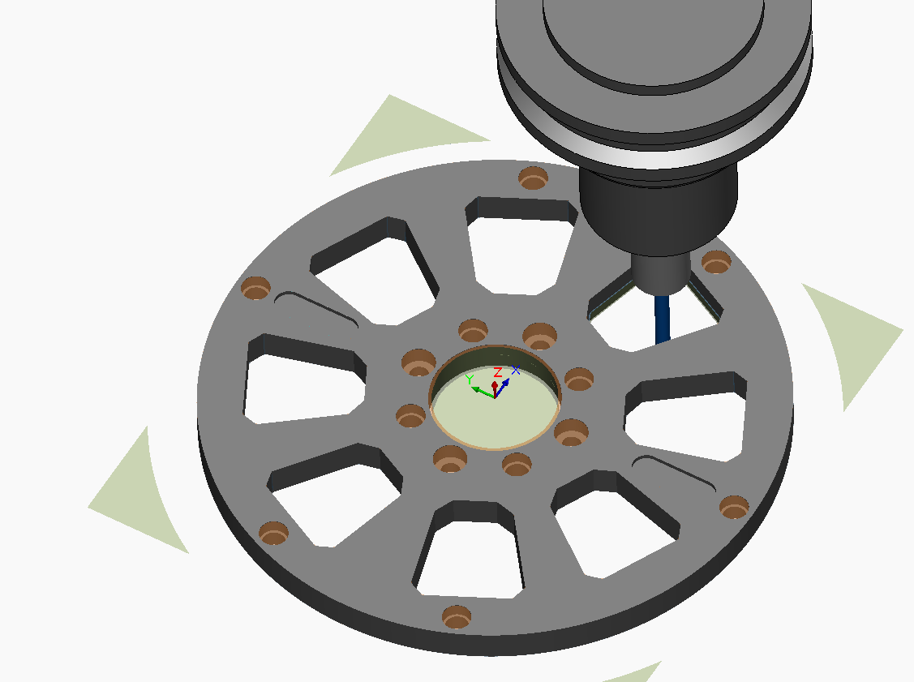
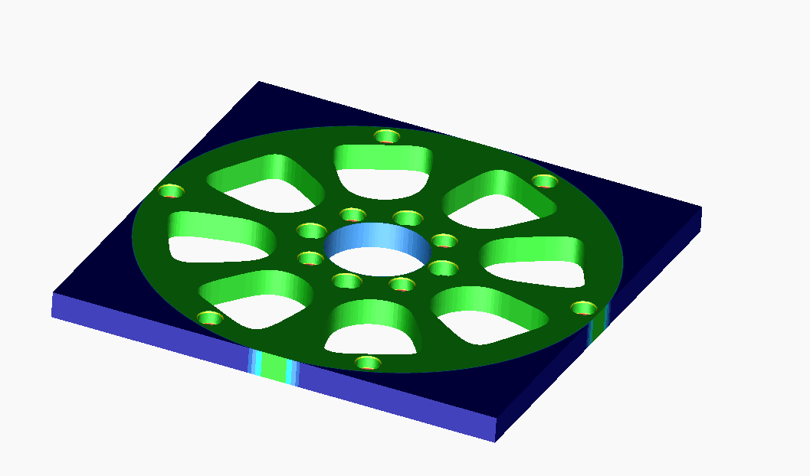
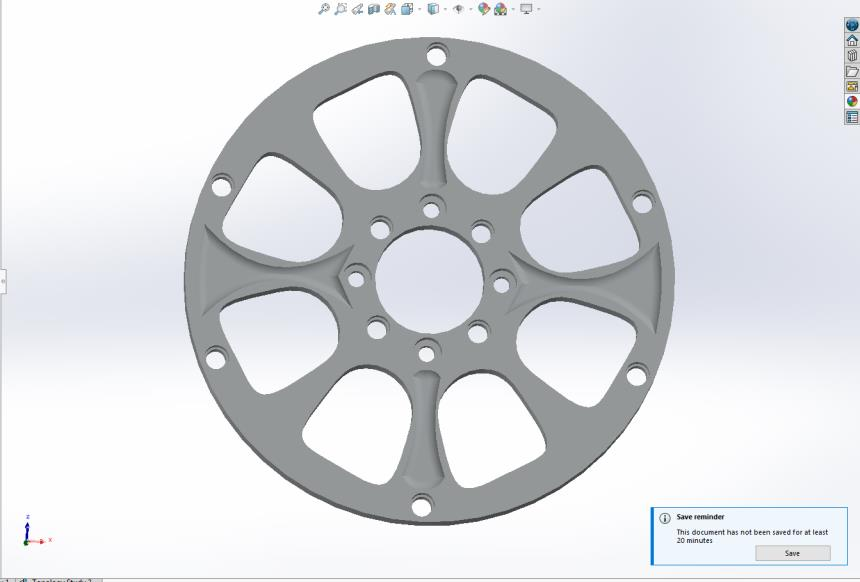
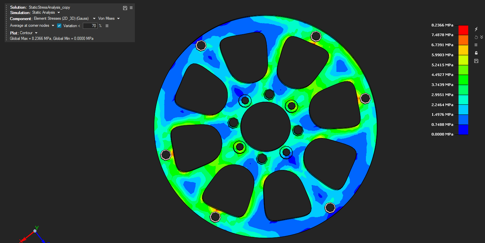
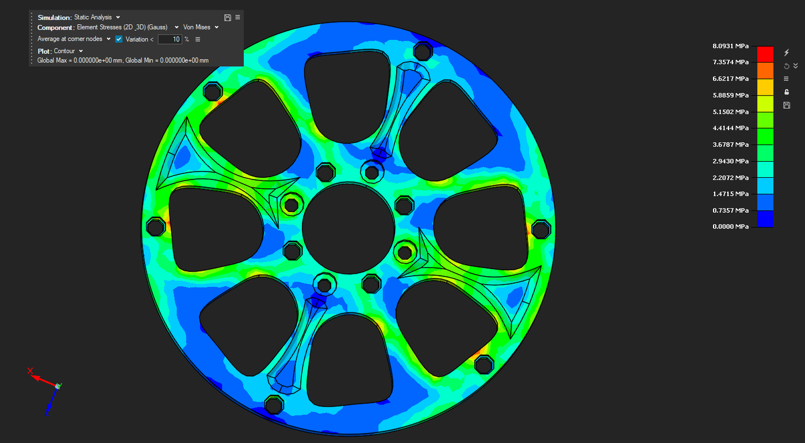

# Quadruped Robot Hip-Joint Flange — FEA, Topology Optimisation & 4-Axis CNC

**CAD/CAM (EE047-4-3) · Asia Pacific University · 2026**

Design-to-manufacture of the **HFE (hip flexion/extension) joint reducer flange plate** for a quadrupedal robot. The plate connects the reducer output shaft to the leg link and is made from **Aluminium 6061-T6**. The work covers CAD, CNC toolpath generation in SOLIDWORKS CAM, static and fatigue FEA, and **SIMP topology optimisation** in Altair SimLab, then re-validating the optimised part and its toolpaths.

## Results

| | Original | Topology-optimised |
|---|---|---|
| Mass | 111.75 g | **109.76 g (−1.78%)** |
| Max von Mises stress | 8.09 MPa | **8.09 MPa (unchanged)** |
| Max displacement | 0.002169 mm | 0.002162 mm |
| Factor of safety vs yield (276 MPa) | ~34.1 | ~34.1 |
| Toolpath time (4 operations evaluated) | baseline | **−14.6% (−0.075 min per part)** |

Load case: **1,000 N·mm torsion plus 1,000 N lateral force** at the hub, the peak operating load at the HFE joint during locomotion. Fatigue was checked against the ~96 MPa endurance limit for 2–4 Hz gait cycles. Across four HFE joints, the mass saving is 7.96 g of lower inertia at dynamically loaded joints.

## Part

- Ø120 mm × 7 mm disc, cut from a 120 × 7 × 120 mm 6061-T6 blank
- Ø26.89 mm hub through-bore for the reducer output shaft
- Inner bolt circle: Ø7 mm holes at 17.80 mm pitch radius (M6 hub clamping)
- Outer bolt circle: Ø6 mm holes at 55.80 mm pitch radius (M5 link attachment)
- 10 trapezoidal spoke pockets for mass reduction, and two rim slots for cable routing and angular alignment
- General tolerances to ISO 2768-m

## CAM (SOLIDWORKS CAM, 4-axis mill)

| Toolpath | Simulation |
|---|---|
|  |  |

1. Defined the machine (Mill 4-axis, metric), the fixture coordinate system, the stock and the setup.
2. Extracted machinable features and generated an operation plan.
3. Ran the operation sequence:

| Operation | Tool |
|---|---|
| Rough Mill (spoke pockets) | T01 Ø6 flat end |
| Contour Mill (rim) | T01 Ø6 flat end, 12,000 rpm |
| Center Drill (spot) | T14 Ø10 × 90° center drill |
| Drill (hub bore, peck) | T15 Ø16 × 118° drill |
| Countersink | T11 Ø5 × 90° countersink |

4. Verified with toolpath simulation and a **Show Difference** deviation analysis against the CAD model. The machined surface was mostly 0.00 mm deviation, and the simulation showed no tool–workpiece or tool–fixture collisions.

## Topology optimisation (Altair SimLab, SIMP)

| Element density | Optimised geometry |
|---|---|
|  |  |

- Hub bore and both bolt circles were set as preserved regions, so the solver could not touch functional features.
- The solver converged at **iteration 19**. Material came out of the web areas between spokes, which carried under 5% of peak stress. The five radial spoke load paths were kept.

| Stress before | Stress after |
|---|---|
|  |  |

**Acceptance criteria and standards used:** ISO 12100 (σ_vm below yield; minimal material for the required safety level), ISO 13482 / ISO 10218-1 (FOS ≥ 1.5 for robot structures), ISO 12107 (fatigue), and ISO 2768-m (displacement within the tolerance band). An FMEA was used to evaluate the toolpath changes.

## Tools

SOLIDWORKS · SOLIDWORKS CAM · Altair SimLab (FEA, topology optimisation)
